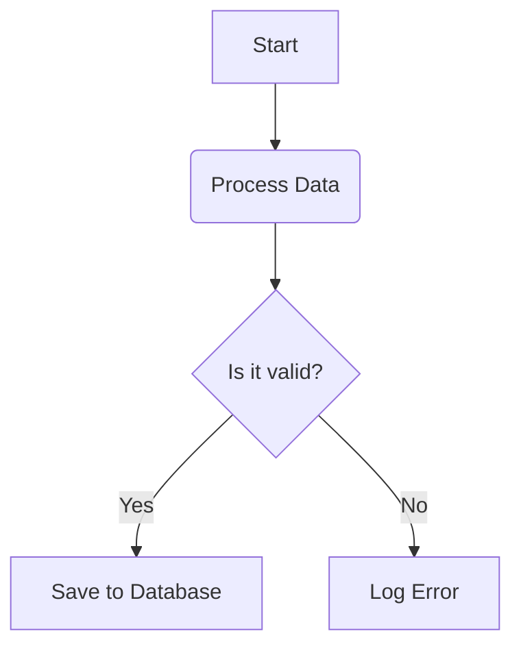
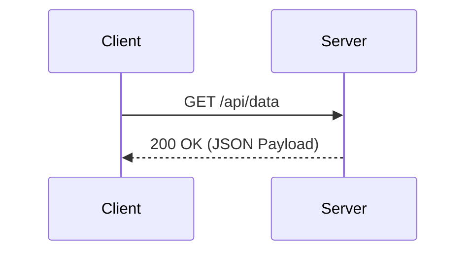

Just checking some formatting techniques in .md files

# Heading
## Sub-heading
### Sub-sub heading

Separator example

Section 1

---

Section 2 

Lists: 

- Something1
- Something2
- Something3

* Something1
    * Something 1.1
    * Something 1.2
        * Something 1.2.1
* Something2
* Something3

1. Something1
    1. Something1.1
    2. Something1.2
2. Something2
3. Something3

Link Styles:
- Know more about me [Linkedin profile](https://www.linkedin.com/in/soumya-iyer-56133216/)
- Know more about me [Linkedin](https://www.linkedin.com/in/soumya-iyer-56133216/ "Go to Linkedin profile") to view repository. This one with a hover.
- Please visit <https://www.linkedin.com/in/soumya-iyer-56133216/> for more information.

Read the [Algorithm](ALGORITHM.md) before starting. Link to another file.

Jump straight to the [What it does](#what-it-does). Example of anchor heading.

You can also use relative path and anchor heading combination

This is an inline sentence pointing to an [External Site][site-ref] and an [Internal File][file-ref]. Notice I left a complete blank line for it to work on github.

[site-ref]: https://www.linkedin.com/in/soumya-iyer-56133216/ "My Linkedin Profile"
[file-ref]: ALGORITHM.md

Embed images

So now I can use these techniques to create pretty, neat and organized .md files in the future!

